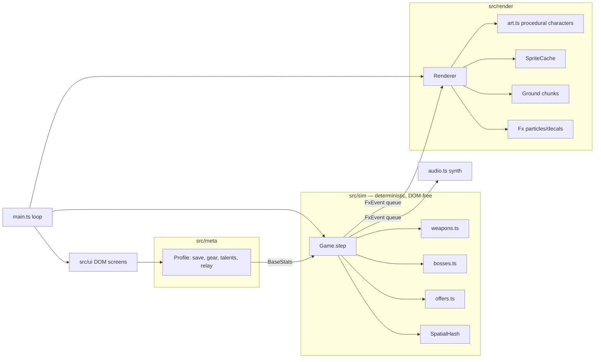

# Dead Signal

A one-thumb sci-fi zombie survivor-like ("bullet heaven") for mobile web, in the spirit of Survivor.io.

> A broadcast went out at 03:14 and turned the city. You're the last courier with a working signal rig.

- **Run:** 10 minutes per sector. Auto-firing weapons, hordes, elites with chests, a mid-boss at 5:00 and a final boss at 10:00 in a caged arena.
- **Build:** 8 weapons × 8 passives. Max a weapon, own its partner passive, and the next chest evolves it.
- **Progression:** 10 sectors, 6-slot gear with 6 rarities and 3→1 merging, talents with account-level milestones, supply crates, an idle Signal Relay and a daily ration.
- **No assets:** every character, icon, floor and sound is generated in code. ~45 KB gzipped.

The design rationale (with sources) is in [`docs/DESIGN.md`](docs/DESIGN.md).

## Play

- Phone: open the GitHub Pages link and "Add to Home Screen" for fullscreen.
- Desktop: WASD / arrow keys, Esc to pause. Drag with the mouse also works.

## Develop

```bash
npm install
npm run dev        # http://localhost:5173  (art gallery at /gallery.html)
npm test           # unit tests (sim + economy)
npm run sim        # headless balance runs: npm run sim -- <runs> <atk> <hp> <sectors>
npm run build      # production bundle in dist/
```

Screenshot tooling (needs a local Chromium): `scripts/playtest.mjs`, `scripts/uitour.mjs`, `scripts/shot.mjs`.

## Architecture



The simulation never touches the DOM, so the same code runs in the browser, in unit tests, and in the headless balance bot.

## Deploy

Pushes to `main` build and deploy via GitHub Actions (`.github/workflows/deploy.yml`). One-time setup: repo **Settings → Pages → Source: GitHub Actions**.
