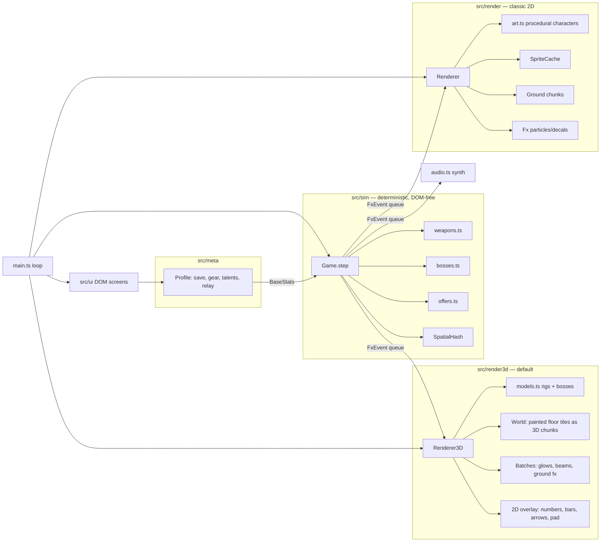

# Dead Signal

A one-thumb sci-fi zombie survivor-like ("bullet heaven") for mobile web, in the spirit of Survivor.io.

> A broadcast went out at 03:14 and turned the city. You're the last courier with a working signal rig.

- **Run:** 10 minutes per sector. Auto-firing weapons, hordes, elites with chests, a mid-boss at 5:00 and a final boss at 10:00 in a caged arena.
- **Build:** 8 weapons × 8 passives. Max a weapon, own its partner passive, and the next chest evolves it.
- **Progression:** 10 sectors, 6-slot gear with 6 rarities and 3→1 merging, talents with account-level milestones, supply crates, an idle Signal Relay and a daily ration.
- **3D by default:** a Three.js renderer draws the same sim. The courier and the four bosses are rigged, hand-animated models (KayKit by Kay Lousberg, CC0) restyled in code with helmets, gear and glowing signal parts; the horde is procedural, with knees, elbows and per-zombie colour variants. The original 2D art is one tap away (Settings → 3D graphics, or `?r=2d`).
- **Almost no assets:** apart from those five character rigs (~0.7 MB gzipped, `src/assets/models/CREDITS.md`), every icon, floor, effect and sound is generated in code.

The design rationale (with sources) is in [`docs/DESIGN.md`](docs/DESIGN.md).

## Play

- Phone: open the GitHub Pages link and "Add to Home Screen" for fullscreen.
- Desktop: WASD / arrow keys, Esc to pause. Drag with the mouse also works.

## Develop

```bash
npm install
npm run dev        # http://localhost:5173  (art gallery at /gallery.html)
npm test           # unit tests (sim + economy)
npm run sim        # headless balance runs: npm run sim -- <runs> <atk> <hp> <sectors>
npm run build      # production bundle in dist/
```

Screenshot tooling (needs a local Chromium): `scripts/playtest.mjs`, `scripts/uitour.mjs`, `scripts/shot.mjs`.

## Architecture



The simulation never touches the DOM, so the same code runs in the browser, in unit tests, and in the headless balance bot. Both renderers read the same sim state and the same `Fx` event queue, which is why the 3D port plays identically: only the picture differs. `scripts/shot3d.mjs` screenshots a full 3D run (hub, mid-boss, final boss, every biome).

## Deploy

Pushes to `main` build and deploy via GitHub Actions (`.github/workflows/deploy.yml`). One-time setup: repo **Settings → Pages → Source: GitHub Actions**.
